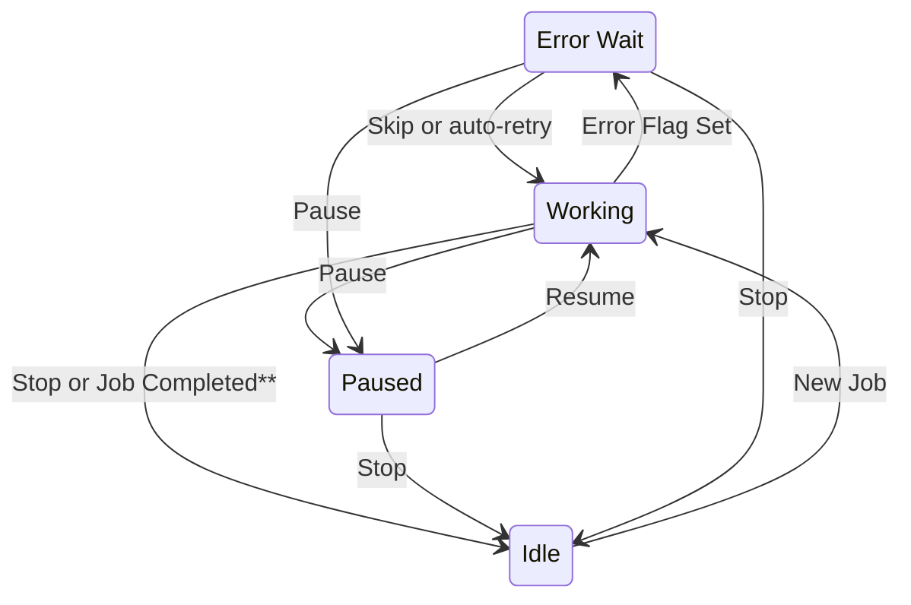

# Phaser Client-Server Protocol

Specification version 1.20

---
- [Revision History](#revision-history)
- [Overview](#overview)
- [Client Commands](#client-commands)
  - [Standard Commands](#standard-commands): [Cavities](#cavities), [Start](#start), [Stop](#stop), [Pause](#pause), [Resume](#resume), [Skip](#skip), [Apply-Corrections](#apply-corrections)
  - [Administrator Commands](#administrator-commands): [Quiet](#quiet), [Bye](#bye), [Reconfigure](#reconfigure), [Version](#version), [Mode](#mode), [Clients](#clients), [Exit](#exit)
- [Server Notifications](#server-notifications)
  - [Server Status Notification](#server-status-notification): [Status](#status)
  - [Phasing Job Change Notification](#phasing-job-change-notification): [Job](#job)
  - [Phasing Job Progress Notifications](#phasing-job-progress-notifications): [Paused](#paused), [Loop](#loop), [Cavity](#cavity), [Progress](#progress)
- [Assumptions](#assumptions)
- [Further Reading](#further-reading)
---

## Revision History

| Date       | Version | Description | Author |
|------------|---------|-------------|--------|
| 2014-06-17 | 1.0  | Initial proposal | Ryan Slominski |
| 2014-06-17 | 1.1  | Refactored with feedback from cjs | Ryan Slominski |
| 2014-06-18 | 1.2  | Refactored with feedback from cjs | Ryan Slominski |
| 2014-06-23 | 1.3  | Add new line message delimiter | Ryan Slominski |
| 2014-06-23 | 1.4  | Clarified new line delimiter consequences | Ryan Slominski |
| 2014-06-25 | 1.5  | Simplified loop and correct modes; added cavities command, added start attribute to plan notification | Ryan Slominski |
| 2014-06-27 | 1.6  | Clarified case-sensitivity, "ok" response, time format, eligible cavities, and progress vs status notifications | Ryan Slominski |
| 2014-06-30 | 1.7  | Moved ping to admin commands section, separated server message from status notification, created sub-notifications | Ryan Slominski |
| 2014-07-02 | 1.8  | Updated admin commands, clarified idempotent commands | Ryan Slominski |
| 2014-07-10 | 1.9  | Renamed Crest to Phaser. Renamed Plan to Job. Added progress notification and updated plan notification to include progress. Client is responsible for clearing progress on pause. Clarified Job States. Added quiet administrator command. Removed history from protocol; querying the database is now the client's responsibility. | Ryan Slominski |
| 2014-07-10 | 1.10 | Added job-id to job change notification | Ryan Slominski |
| 2014-07-21 | 1.11 | Added error flag on status message | Ryan Slominski |
| 2016-03-07 | 1.12 | Added "Samples Per Kick" and "Max Mommentum Error" as job attributes. Added "configure" command. Added "apply-corrections" command to apply corrections measured via a given job all at once. Added "skip" command. | Ryan Slominski |
| 2016-03-08 | 1.13 | Added "version" command. Progress notification now includes text. Error notification clarified. | Ryan Slominski |
| 2016-03-09 | 1.14 | Moved progress label to progress notification instead of cavity notification. Removed cavity attribute of skip command. Add constraint to when skip can be used. | Ryan Slominski |
| 2016-03-10 | 1.15 | Updated apply-changes command to use cavity result record IDs instead of job ID. | Ryan Slominski |
| 2016-03-10 | 1.16 | Added Admin commands "live" and "test" | Ryan Slominski |
| 2016-03-18 | 1.17 | Cleaned up document: state diagram stop from pause, consistent font; Cavity notification timezone implied local | Ryan Slominski |
| 2016-03-28 | 1.18 | Added "mode" command. Updated version and clients commands to use a response key that echos the command name. | Ryan Slominski |
| 2016-04-05 | 1.19 | Removed live and test commands | Ryan Slominski |
| 2026-11-02 | 1.20 | Added "warning" response. Skip is honored only in the wait between cavities, resume warns if the job isn't paused, and reconfigure isn't implemented (phaser-server #32). Converted from Word to Markdown; corrected the status error and cavity notification examples. | Claude Code (AI agent) |

## Overview

Communication between client and server is in UTF-8 encoded JSON String format. All dates are represented in the following ISO 8601 format unless otherwise indicated: YYYY-MM-DDThh:mm:ss (extended date and time to second resolution and implied local time zone). The clients are essentially stateless and all state is maintained on the server. There are three types of messages:

1. **Commands** - which are sent from the client and received by the server
2. **Responses** - which are sent from the server to the client in response to a command
3. **Notifications** - which are sent from the server and received by the client

All messages are wrapped in a JSON object and have either an attribute named "command", "response", or "notification". All messages are terminated with a new line delimiter to make parsing easy. Note that including a new line in the actual content of a JSON String must be escaped per JSON specification. The JSON specification allows whitespace (including newlines) between any pair of tokens. However, including a new line between tokens is not allowed per this protocol since we rely on a newline to delimit a message. All messages are case-sensitive and in general are all lowercase except where noted.

There are two types of commands: standard and administrator. All client commands are synchronous and require a response of "ok", "warning" or "error". If the response is "warning" or "error" then an attribute named "message" must also be supplied. A "warning" means the server understood the command but did not carry it out, because it does not apply to the phasing job's current state; nothing was changed. For example:

```json
{"response": "ok"}
```

Or if there is an error:

```json
{"response": "error", "message": "You cannot pause because there is not a Phaser job running"}
```

Or if the command does not apply to the job's current state:

```json
{"response": "warning", "message": "The job isn't paused"}
```

Clients submit jobs to the server and the server broadcasts the configuration and status of the job to all clients. There can only be one job running at a time. See the state diagram in Figure 1:

**Figure 1: Phaser Client\* Job State**



A client starts up in, and shuts down from, any state.

\*Server Job state is the same except startup always begins in the "Idle" state.

\*\*If a Job cannot be started due to an error such as the database being unavailable then the server state returns to "Idle" with a server status message explaining the issue.

In the event multiple clients issue concurrent idempotent commands the server will return "ok" to all clients even though the command was performed only once. For example if two clients push the "pause" button concurrently while the server is working on a job then both will see "ok" response even though the server only executed the first one received. Resume is the exception: the first resume runs the job, and a concurrent second resume gets a "warning" because the job is no longer paused (see [Resume](#resume)). The response to some client commands may also include a payload if the response is "ok". When the server sends the "ok" response it means several things:

1. The server understood the command
2. The server executed the command and it completed successfully
3. Any client notifications as a result of the command have already been sent

There are three types of notifications: server status, phasing job change, and phasing job progress. The server status notification is a message of the server's choosing that is displayed to the client until the server clears it or replaces it with a new message. The phasing job change notification is sent when a client first connects as well as when a phasing job starts or completes. Progress notifications update the client on the progress of phasing and only are sent when there is a phasing job in progress.

## Client Commands

### Standard Commands

These are the standard commands for interacting with the Phaser server. The main GUI client supports all of these commands.

#### Cavities

Obtain an array of all cavities which are eligible for phasing (cryo-quarter module is likely omitted) as known by the CED and sorted in ascending s-coordinate order (distance from injector/gun on beam line).

##### Example

```json
{"command": "cavities"}
```

##### Response Example

```
{"response": "ok", "cavities": ["0L03-1", "0L03-2",...]}
```

#### Start

Start phasing with the supplied Phaser job.

##### Attributes

There is an object attribute named job. The job attribute indicates the phasing job and has the following attributes:

- **correct** – true for "correct" and false for "diagnose". Indicates whether the computed correction is applied or simply logged.
- **continuous** – true for "continuous" and false for "run once".
- **max-phase-error** - the maximum phase angle error allowed which indicates how accurate and how invasive the phasing will be and is measured in degrees with a scale of two decimals. Note: if phasing runs continuously the server may lower the max-error for a cavity after phasing it for the first time since it will know recent phase error.
- **max-momentum-error** – the maximum momentum error allowed which is measured in dp/p and will be in floating point or scientific notation format.
- **kick-samples** – the number of samples per kick (not to be confused with number of kicks) in positive integer format.
- **cavities** – a non-empty array of cavities which must not contain duplicates and each cavity must match a cavity name as specified in the CED.

##### Example

```json
{"command": "start", "job": {"correct": true, "continuous": true, "max-phase-error": 10, "max-momentum-error": 1e-3, "kick-samples": 8, "cavities": ["0L03-1", "0L03-2", "0L03-3"]}}
```

#### Stop

Stop phasing if a Phaser job is being executed and clear the phasing job.

##### Example

```json
{"command": "stop"}
```

#### Pause

Pause phasing if a Phaser job is being executed. The server should remain in a state such that any client could resume phasing at a later time at the point at which the phasing job was left off. If the server should crash then loss of state is acceptable. If the pause command is issued in the middle of phasing a cavity then the server must abandon all work done on the current cavity to make the pause more responsive. Upon resuming later the incomplete cavity will be re-phased from scratch.

##### Example

```json
{"command": "pause"}
```

#### Resume

Resume phasing of the paused Phaser job. If the job is not paused the server replies "warning" with the message "The job isn't paused" and leaves the job unchanged. If there is no job the server replies "error".

##### Example

```json
{"command": "resume"}
```

##### Warning Example

```json
{"response": "warning", "message": "The job isn't paused"}
```

#### Skip

Skips phasing of the cavity the server would measure next. The server honors skip only in the wait between cavities, while the progress label reads "Waiting". After a measurement that failed, which the server would otherwise retry, it skips that cavity; after a measurement that succeeded the job has already moved on, so it skips the next cavity in the job. At any other time, such as during a measurement, with no job, or with a paused job, the server replies "warning" with the message "Skip is honored only in the wait between cavities" and nothing is skipped.

##### Example

```json
{"command": "skip"}
```

##### Warning Example

```json
{"response": "warning", "message": "Skip is honored only in the wait between cavities"}
```

#### Apply-Corrections

Apply the phase error corrections found in the supplied Cavity Result ID array. Note: no notifications result from this command; only the client that issues the command is aware of it. Otherwise per usual "ok" response means it was completed successfully and "error" means it didn't work.

##### Attributes

- **results** – the Cavity Result ID array.

##### Example

```json
{"command": "apply-corrections", "results": [1, 2, 3, 4, 5, 6]}
```

### Administrator Commands

These commands are generally used by special clients and are used to control or debug the server. The main GUI client does not support any of these commands except for version.

#### Quiet

This command asks the server to toggle whether or not it should send the client notifications.

##### Example

```json
{"command": "quiet"}
```

#### Bye

This command asks the server to gracefully end communication with the client.

##### Example

```json
{"command": "bye"}
```

#### Reconfigure

This command is not implemented: the server replies "error" with a message that starts "Not implemented - " followed by the request, and changes nothing. It was meant to ask the server to reconfigure, which generally means reload configuration files and query the CED and then apply any configuration changes.

##### Example

```json
{"command": "reconfigure"}
```

#### Version

This command asks the server for the server version string.

##### Example

```json
{"command": "version"}
```

##### Example Response

```json
{"response": "ok", "version": "1.0"}
```

#### Mode

This command asks the server for the current mode.

##### Example

```json
{"command": "mode"}
```

##### Example Response

```json
{"response": "ok", "mode": "live"}
```

#### Clients

This command asks the server for the number of clients.

##### Example

```json
{"command": "clients"}
```

##### Example Response

```json
{"response": "ok", "clients": 1}
```

#### Exit

This command asks the server to shut down.

##### Example

```json
{"command": "exit"}
```

## Server Notifications

### Server Status Notification

#### Status

This notification informs clients of detailed information regarding server status. It should replace any message previously sent. If null the message previously sent message should be cleared. If a job is currently set on the server then the message may include a boolean attribute named "error" with value "true" to indicate that an error has occurred, but the server will continue to retry indefinitely.

##### Example

```json
{"notification": "status", "message": "Job #3 completed on 5 Aug 2014 10:45"}
```

##### Error Example

```json
{"notification": "status", "message": "The database is unavailable; retrying in 30 seconds", "error": true}
```

### Phasing Job Change Notification

This notification is sent when a client first connects, whenever a Phaser job starts, and whenever a Phaser job ends.

#### Job

This notification informs clients of the Phaser job. When a Phaser job runs to completion or is stopped the job is removed and the "job" attribute will be null to indicate this.

##### Attributes

When the job attribute is null (job complete) then all other attributes are to be omitted. The attributes which mirror progress notifications are described in more detail in the progress notification section. The attributes are:

- **start** - the start time of the job in ISO 8601 format.
- **paused** – true if the job is paused, false otherwise.
- **loop** – the current loop over the job cavities.
- **cavity** – the current cavity being phased.
- **cavity-start** – the start time of the current cavity
- **progress** – the progress percent.
- **label** – the progress label.
- **job-id** – the job identifier (number)
- **job** – the job object, which contains:
  - **correct** – true for "correct" and false for "diagnose".
  - **continuous** – true for "continuous" and false for "run once".
  - **max-phase-error** - the maximum phase angle error.
  - **max-momentum-error** – the maximum momentum error (dp/p).
  - **kick-samples** – the number of samples per kick.
  - **cavities** – a non-empty array of cavities.

##### Example

```json
{"notification": "job", "job": {"correct": true, "continuous": true, "max-phase-error": 10, "max-momentum-error": 1e-3, "kick-samples": 8, "cavities": ["0L03-1", "0L03-2", "0L03-3"]}, "start": "2014-06-16T13:30:00", "paused": false, "loop": 1, "cavity": "0L03-1", "cavity-start": "2014-06-16T13:30:00", "progress": 25, "label": "0L03-1", "job-id": 47}
```

When the notification is that there is no job the message will look like:

```json
{"notification": "job", "job": null}
```

### Phasing Job Progress Notifications

These notifications update the user on Phaser job progress. These notifications are only needed when a Phaser job is in place (clients should ignore unsolicited notifications).

#### Paused

This notification informs clients whether the current Phaser job is paused or not. The client is responsible for clearing the cavity progress percent when they receive a pause notification (there will be no separate progress notification after every pause as it is implied).

##### Attributes

The status notification has an attribute "paused", which has a value that can be true or false

##### Example

```json
{"notification": "paused", "paused": true}
```

#### Loop

This notification informs clients of the current processing loop over the set of cavities to phase. The count attribute must not be null. The loop counter should start at 1. There is no need to send a notification to clients when a job is complete to reset this to 1 (or null) as the job change notification of null will indicate that clients must reset the field.

##### Attributes

- **count** – the loop number.

##### Example

```json
{"notification": "loop", "count": 1}
```

#### Cavity

This notification informs clients of which cavity is currently being phased. Both attributes must not be null. There is no need to send a notification when done with a cavity as the either the next cavity notification or the job change with null value will be enough for the client to know to reset the field.

##### Attributes

- **start** – the official start time. ISO 8601 formatted timestamp with second resolution and local time zone is implicit.
- **name** – the cavity name. Should be a name from the CED.

##### Example

```json
{"notification": "cavity", "start": "2014-06-16T13:30:00", "name": "1L02-1"}
```

#### Progress

This notification informs clients of the percent complete (0-100) progress of the current cavity. The value must not be null. There may be little reason (but not forbidden) to send progress notifications with values 0 or 100 as those states are implied by cavity / job change notifications.

##### Attributes

- **value** – any integer between 0 and 100 inclusive.
- **label** – a short label (max 24 char) indicating progress. This label is displayed within the progress bar. This label should match the cavity name (or read "Kicking/Measuring...") or read "Waiting..." allowing the progress bar to go from 0 to 100 twice per cavity.

##### Example

```json
{"notification": "progress", "value": 50}
```

## Assumptions

1. We are no longer going to support Gang Phase Cresting.
2. There is no such thing as non-invasive perturbations. Instead users can supply a maximum phase angle error number.

## Further Reading

1. JSON Specification - <http://json.org/>
2. ISO 8601 - <http://en.wikipedia.org/wiki/ISO_8601>
